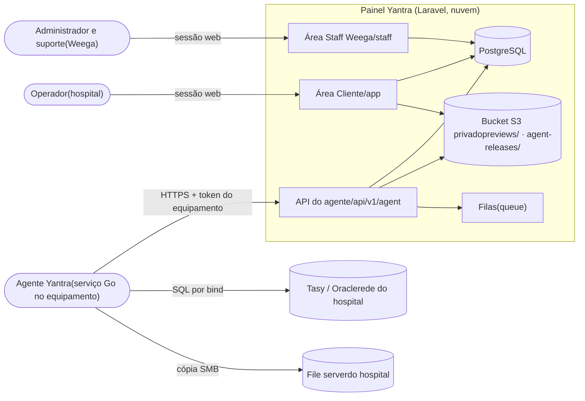
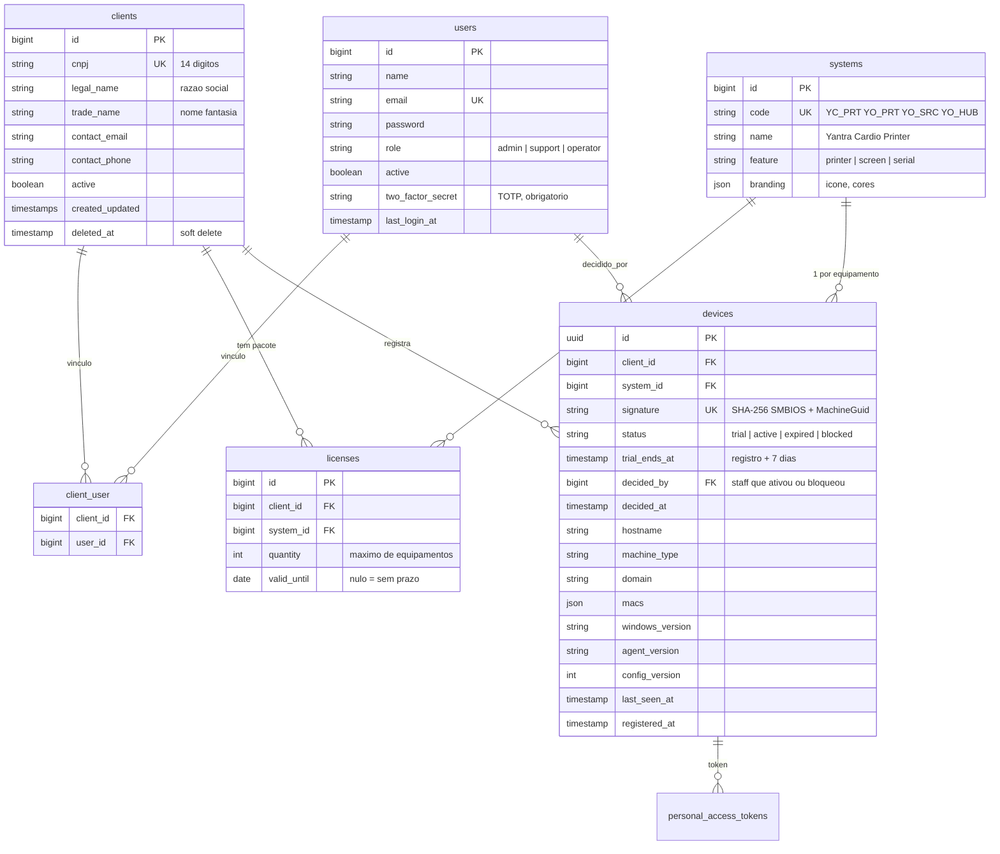
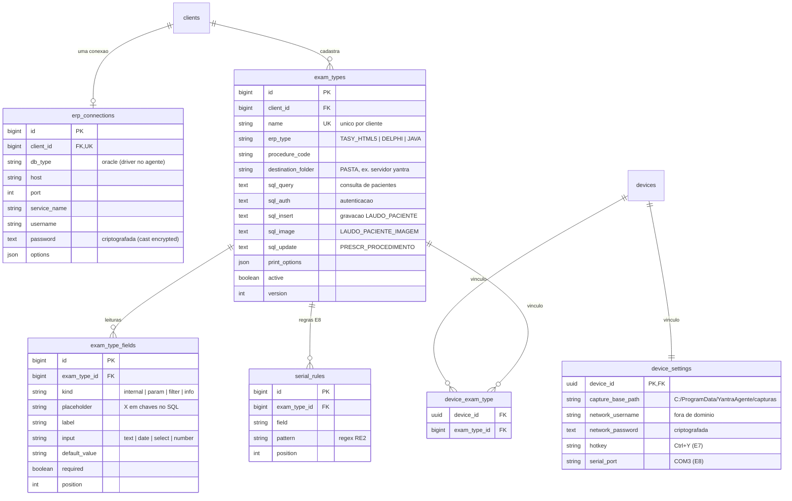
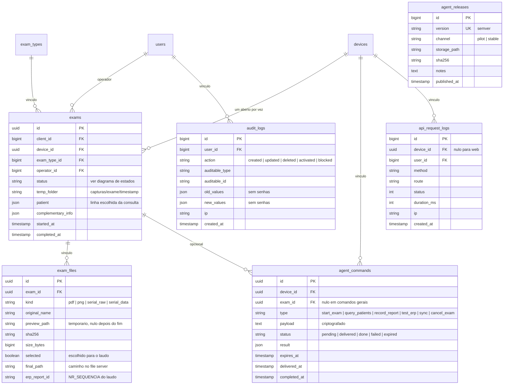
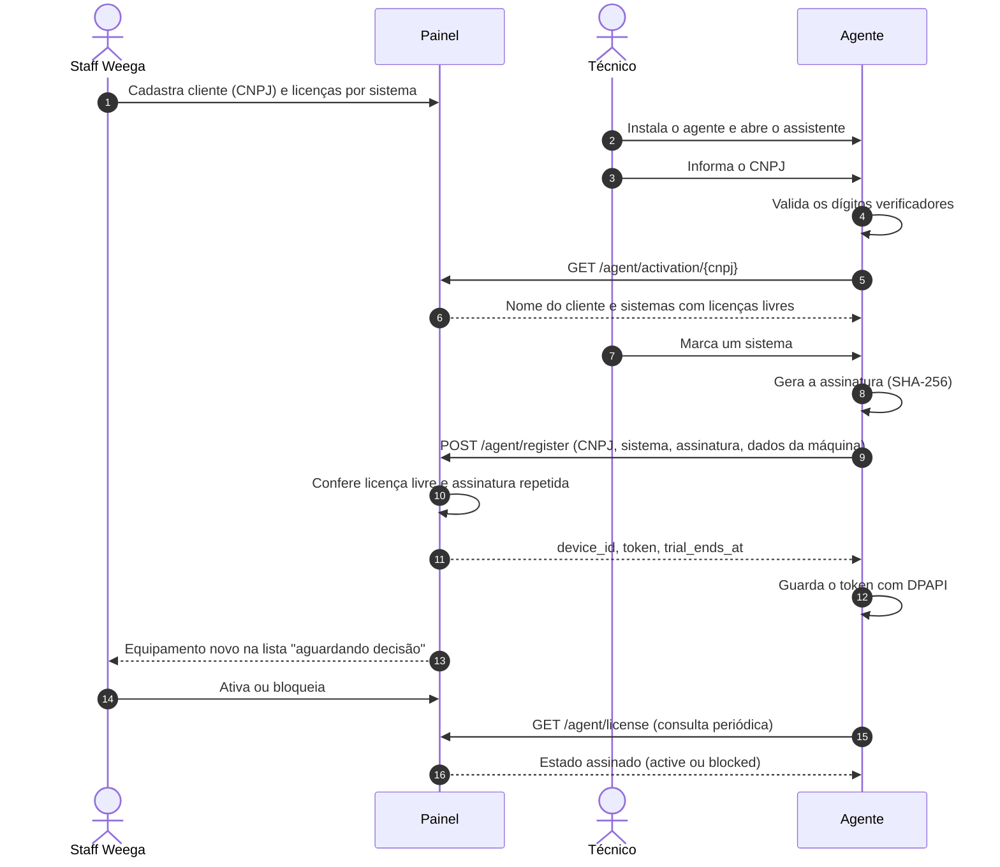
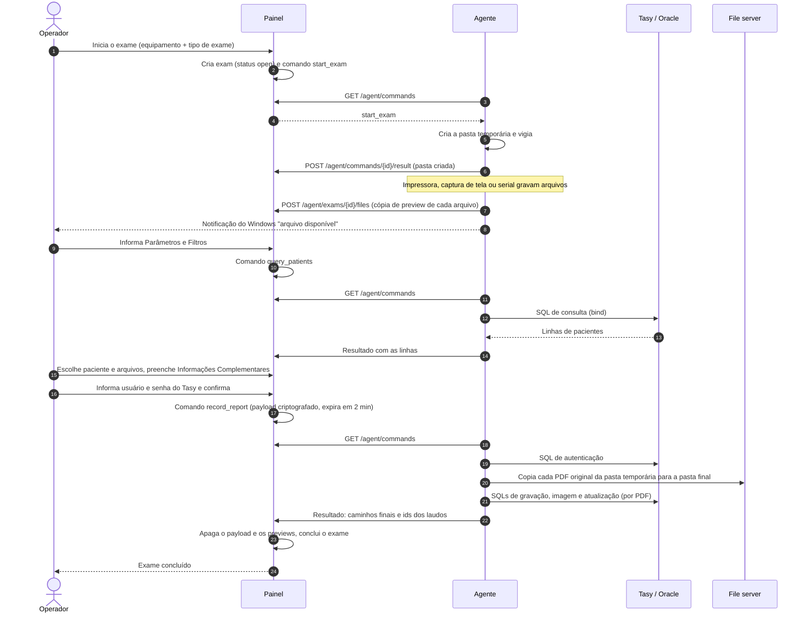
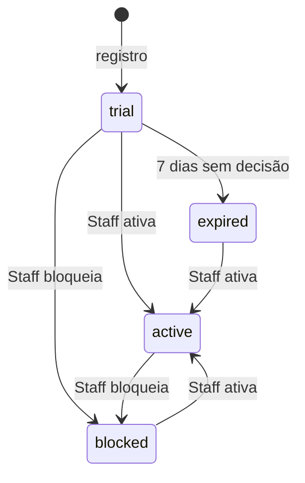
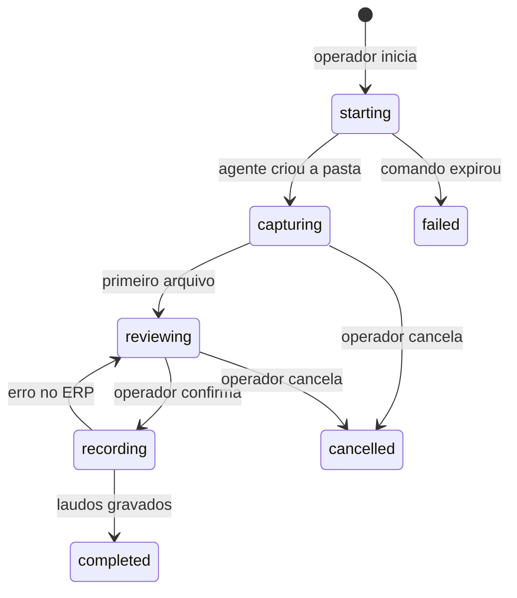

Yantra Painel · Especificação do administrativo

# Painel Yantra

O painel é a API e as telas do administrativo, em Laravel, na nuvem. Esta página define o modelo de dados, os fluxos, as regras, as telas e a API do agente. Ela é a referência para as migrations da E0 e para o contrato OpenAPI.

[1 Visão geral](#visao) [2 Modelo de dados](#modelo) [3 Fluxos](#fluxos) [4 Estados](#estados) [5 Regras](#regras) [6 Telas](#telas) [7 API do agente](#api) [8 Perguntas](#perguntas)

1 · Visão geral

## Quem usa o painel

O painel atende três tipos de cliente da API. Cada tipo tem uma forma própria de autenticação e uma área própria.

| Ator | Autenticação | O que faz |
| --- | --- | --- |
| STAFF Administrador | Login web com senha e 2FA | Tudo: clientes, usuários, licenças, exames, SQLs, conexões, versões do agente, ativação de equipamentos. |
| STAFF Suporte | Login web com senha e 2FA | Consulta tudo. Ativa e bloqueia equipamentos. Não altera SQLs, conexões nem licenças. |
| CLIENTE Operador | Login web com senha e 2FA | Inicia exames, escolhe o paciente e os arquivos, confirma o laudo. Vê só os dados dos clientes vinculados. |
| AGENTE Equipamento | Token Bearer do equipamento (Sanctum) | Registra o equipamento, consulta licença, parâmetros e comandos, envia arquivos e resultados. |

2 · Modelo de dados

## Tabelas e relações

As tabelas usam nomes em inglês, no padrão do Laravel. A tabela abaixo dá o nome em português de cada uma. O modelo tem três grupos: cadastro e licenças, exames e ERP, e operação.

| Tabela | Nome no painel | Etapa |
| --- | --- | --- |
| `clients` | Clientes (empresas, por CNPJ) | E1 |
| `users`, `client_user` | Usuários e vínculo usuário → cliente | E1 |
| `systems` | Sistemas: YC PRT, YO PRT, YO SRC, YO HUB | E3 |
| `licenses` | Licenças: quantidade por cliente e sistema | E3 |
| `devices` | Equipamentos (instalações do agente) | E2 |
| `personal_access_tokens` | Tokens dos equipamentos (Sanctum) | E0 |
| `erp_connections` | Conexão do ERP (uma por cliente) | E5 |
| `exam_types`, `exam_type_fields` | Exames (5 SQLs) e leituras | E5 |
| `device_settings`, `device_exam_type` | Parametrização do equipamento | E5 |
| `exams`, `exam_files` | Exames realizados (ciclos) e dados dos arquivos (sem o conteúdo) | E6 |
| `agent_commands` | Comandos para o agente | E6 |
| `serial_rules` | Regras regex da porta serial | E8 |
| `agent_releases` | Versões do agente (atualização) | E4 |
| `api_request_logs`, `audit_logs` | Log de requisições e auditoria | E1 |

### 2.1 Cadastro, licenças e equipamentos

### 2.2 Exames, ERP e parametrização

### 2.3 Operação: exames realizados, comandos, versões e logs

Os campos sensíveis (`password` da conexão, `network_password`, `payload` dos comandos) usam o cast `encrypted` do Laravel. A auditoria grava a troca desses campos, mas não grava o valor.

3 · Fluxos

## Como as partes conversam

### 3.1 Cadastro prévio e ativação por CNPJ

A Staff Weega cadastra o cliente e as licenças antes da instalação. O técnico instala o agente, informa o CNPJ e escolhe um sistema. Cada instalação nova entra em trial e aparece na lista de decisões da Staff.

### 3.2 Ciclo de exame com o ERP

O operador conduz o exame no painel. O agente faz as partes que precisam da rede do hospital: o Oracle e o file server.

### 3.3 Canal de comandos

O agente consulta `GET /agent/commands` a cada 5 segundos enquanto há um exame aberto. Sem exame aberto, a consulta acontece a cada 30 segundos. A consulta também serve de sinal de vida: ela atualiza `devices.last_seen_at`.

O painel entrega cada comando uma vez. O agente responde com `POST /agent/commands/{id}/result`. Um comando sem resposta até `expires_at` passa para `expired`, e o painel mostra o erro ao operador.

| Comando | Validade | Resultado |
| --- | --- | --- |
| `start_exam` | 5 min | pasta temporária |
| `query_patients` | 1 min | linhas da consulta |
| `record_report` | 2 min | caminhos e ids dos laudos |
| `test_erp` | 1 min | sucesso ou erro do Oracle |
| `cancel_exam` | 5 min | pasta descartada |
| `sync` | 5 min | fila reenviada |

### 3.4 Parâmetros assinados

O painel monta os parâmetros do equipamento num JSON: exames, SQLs, leituras, conexão do ERP, pastas e credencial de rede. O painel assina o JSON com uma chave Ed25519. O agente tem a chave pública no instalador e rejeita parâmetros com assinatura inválida. Cada alteração de exame, conexão ou parametrização aumenta `devices.config_version`. O agente baixa os parâmetros quando a versão muda.

4 · Estados

## Estados do equipamento e do exame

### Equipamento (`devices.status`)

O estado "bloqueado por falta de conexão" existe só no agente, depois de 7 dias sem resposta da API. O painel não guarda esse estado.

### Exame (`exams.status`)

5 · Regras

## Regras de negócio

Cada regra tem um código. Os testes automatizados citam o código da regra que verificam.

### R-ACE Acesso e clientes

1. O CNPJ é único e tem os dígitos verificadores válidos.
2. Um operador vê só os dados dos clientes vinculados a ele. Um escopo global no Eloquent aplica este filtro.
3. Administrador e suporte veem todos os clientes.
4. Só o administrador cria usuários da Staff Weega.
5. Todo login exige 2FA por aplicativo autenticador (TOTP), para a Staff e para o operador. O 2FA é obrigatório: o primeiro login pede o cadastro do autenticador.
6. Um cliente desativado bloqueia o login dos operadores e a API dos equipamentos dele.

### R-LIC Licenças e equipamentos

1. Licença em uso = equipamentos do cliente e do sistema nos estados `trial` ou `active`.
2. O registro só acontece se licença em uso \< `licenses.quantity`. O trial já usa uma licença.
3. O trial termina 7 dias depois do registro. Uma tarefa agendada muda o estado para `expired`.
4. Só a Staff Weega ativa, bloqueia ou desbloqueia um equipamento.
5. Um equipamento tem um sistema só.
6. A mesma assinatura em outro cliente não registra. O painel marca o caso como suspeita de clone.
7. A mesma assinatura no mesmo cliente reaproveita o equipamento e gera um token novo (reinstalação).
8. A consulta por CNPJ tem limite de 10 tentativas por hora por IP.

### R-EXA Exames

1. Um equipamento tem no máximo um exame aberto. Um índice parcial no PostgreSQL garante a regra.
2. O operador inicia exame só em equipamento `active` ou `trial`, com o tipo de exame habilitado.
3. Só o administrador altera SQLs, conexões do ERP e pastas de destino.
4. Os SQLs usam marcadores `{X}`. O agente troca cada marcador por uma variável de ligação (bind), nunca por texto.
5. A senha do Tasy fica só no payload do comando `record_report`. O painel apaga o payload depois do resultado ou da expiração.
6. O painel não guarda arquivos de exame. O agente envia só uma cópia de preview. O original fica na pasta temporária do equipamento até a cópia para o file server.
7. O painel apaga os previews quando o exame termina: concluído, cancelado ou com falha. Uma tarefa agendada apaga a cada hora os previews com mais de 24 horas. A regra de ciclo de vida do bucket apaga a pasta `previews/` depois de 1 dia, como segunda garantia.
8. Depois do fim do exame, o painel guarda só os dados do arquivo: nome, tamanho, SHA-256, caminho final e id do laudo.

### R-SEG Segurança e auditoria

1. Cada equipamento tem um token Sanctum com a habilidade `agent`. O bloqueio do equipamento não revoga o token: a API responde só a licença.
2. As respostas de licença e de parâmetros têm assinatura Ed25519.
3. O painel registra cada requisição da API em `api_request_logs`, sem corpo e sem cabeçalho de autorização.
4. O painel registra cada ação dos usuários em `audit_logs`, com valor antigo e valor novo.
5. A auditoria nunca grava senhas nem payloads de comando.
6. O upload aceita só PDF, PNG e texto, até 50 MB, e confere o SHA-256 enviado pelo agente.

6 · Telas

## Telas das duas áreas

### Área Staff Weega /staff

E1Início

Equipamentos aguardando decisão, equipamentos sem sinal, exames com erro.

E1Clientes

Lista, cadastro, usuários vinculados, licenças e equipamentos do cliente.

E1Usuários

Staff e operadores, papel, vínculo aos clientes, ativação.

E3Sistemas e licenças

Sistemas e identidade visual. Quantidade por cliente, com o uso atual.

E2Equipamentos

Lista com filtros por cliente, estado e último sinal. Ações: ativar, bloquear.

E5Exames

Cadastro com os 5 SQLs e as leituras. Importação de `EXAME.json` e `PARAMETROS.json`.

E5Conexão do ERP

Uma por cliente. Botão "Testar conexão" envia o comando `test_erp` a um equipamento.

E4Versões do agente

Envio do instalador, canal piloto ou estável, notas da versão.

E1Log e auditoria

Consulta com filtros por data, cliente, equipamento, usuário e rota.

### Área Cliente /app

E6Equipamentos

Equipamentos do cliente, online ou offline, e o exame em andamento.

E6Novo exame

Escolha do equipamento e do tipo de exame.

E6Exame em andamento

Arquivos recebidos com preview, Parâmetros e Filtros, lista de pacientes do ERP, Informações Complementares.

E6Confirmação

Usuário e senha do Tasy, resultado de cada laudo.

E6Histórico

Exames por data, paciente, equipamento e estado.

7 · API do agente

## Endpoints da versão 1

Prefixo `/api/v1/agent`. Todas as respostas usam JSON. O contrato OpenAPI fica publicado em `/api/docs`. A etapa indica quando cada endpoint entra.

| Método e rota | Acesso | Função | Etapa |
| --- | --- | --- | --- |
| `GET /activation/{cnpj}` | PÚBLICO | Nome do cliente e sistemas com licenças livres. Limite R-LIC-8. | E2 |
| `POST /register` | PÚBLICO | Registra o equipamento e devolve o token. | E2 |
| `GET /license` | TOKEN | Estado da licença e sistema liberado, com assinatura. | E3 |
| `GET /config` | TOKEN | Parâmetros assinados, com `config_version`. | E5 |
| `GET /commands` | TOKEN | Comandos pendentes. Atualiza o último sinal. | E6 |
| `POST /commands/{id}/result` | TOKEN | Resultado de um comando. | E6 |
| `POST /exams/{id}/files` | TOKEN | Envio da cópia de preview de um arquivo (multipart, com SHA-256). O painel apaga a cópia no fim do exame. | E6 |
| `POST /exams/{id}/data` | TOKEN | Dados extraídos da porta serial. | E8 |
| `GET /updates/latest` | TOKEN | Versão disponível, URL temporária e SHA-256. | E4 |

Os nomes refinam os endpoints do Plano do Agente. Exemplo: `POST /agents/register` passa a ser `POST /api/v1/agent/register`. O equipamento sai do token, por isso as rotas não têm `{id}` do equipamento.

8 · Decisões e perguntas

## Decisões do painel

1. **Interface:** Livewire 4 com Flux UI (kit inicial do Laravel 13). As telas ficam em PHP e Blade. (decidido em 25/10/2026)
2. **2FA:** obrigatório para todos os usuários, Staff e operador, por aplicativo autenticador (TOTP). (decidido em 25/10/2026)
3. **Arquivos de exame:** o painel não guarda arquivos. O painel mostra só um preview temporário, e o agente copia os originais para o file server do hospital. (decidido em 25/10/2026)
4. **Armazenamento:** um bucket S3 privado, com duas pastas. (decidido em 25/10/2026)
   - `previews/<cliente>/<exame>/<arquivo>`: cópias de preview. O painel apaga a pasta do exame no fim do exame. A regra de ciclo de vida apaga qualquer objeto com mais de 1 dia.
   - `agent-releases/<versão>/YantraAgente-Setup-<versão>.exe`: instaladores do agente, sem prazo de expiração.
   - O bucket bloqueia o acesso público e criptografa os objetos (SSE-S3). O navegador e o agente baixam os arquivos só por URLs assinadas, com validade de poucos minutos.
   - Em desenvolvimento, o Docker roda o LocalStack, que usa a mesma API do S3. O código do painel é o mesmo nos dois ambientes. O LocalStack community não confere permissões: o acesso privado só vale no S3 da AWS.

5. **Hospedagem:** AWS, região de São Paulo (`sa-east-1`), por causa da LGPD e da latência. (decidido em 25/10/2026)

Nenhuma pergunta em aberto.